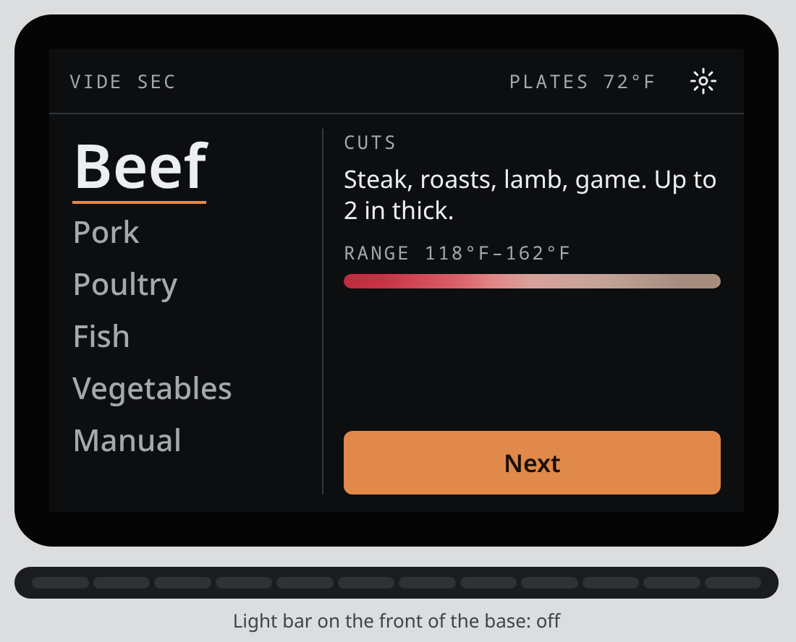
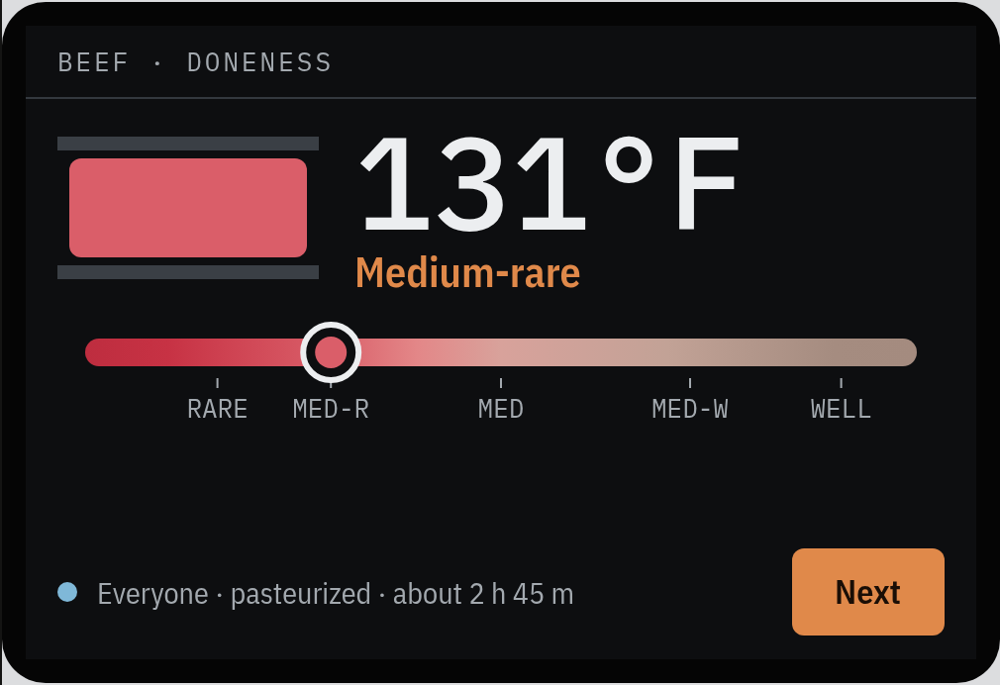
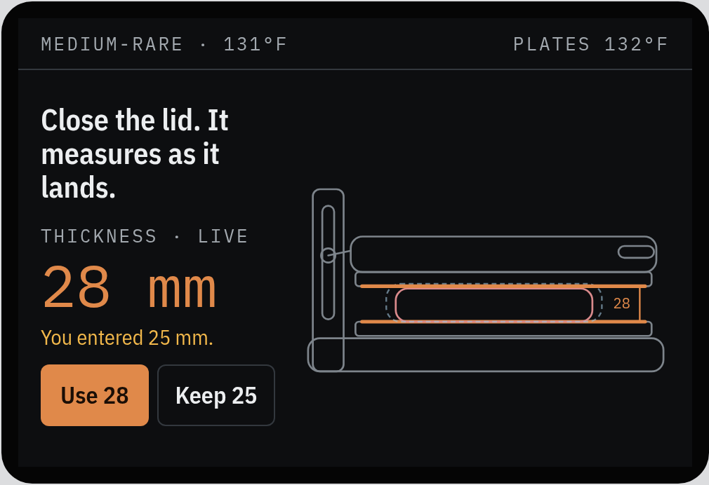
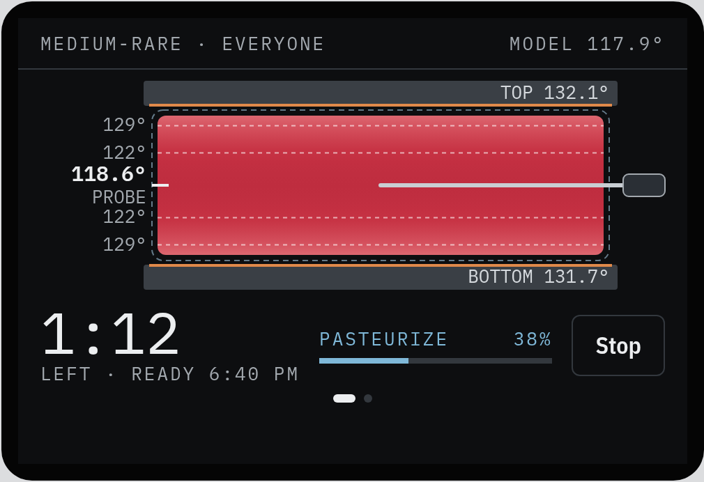
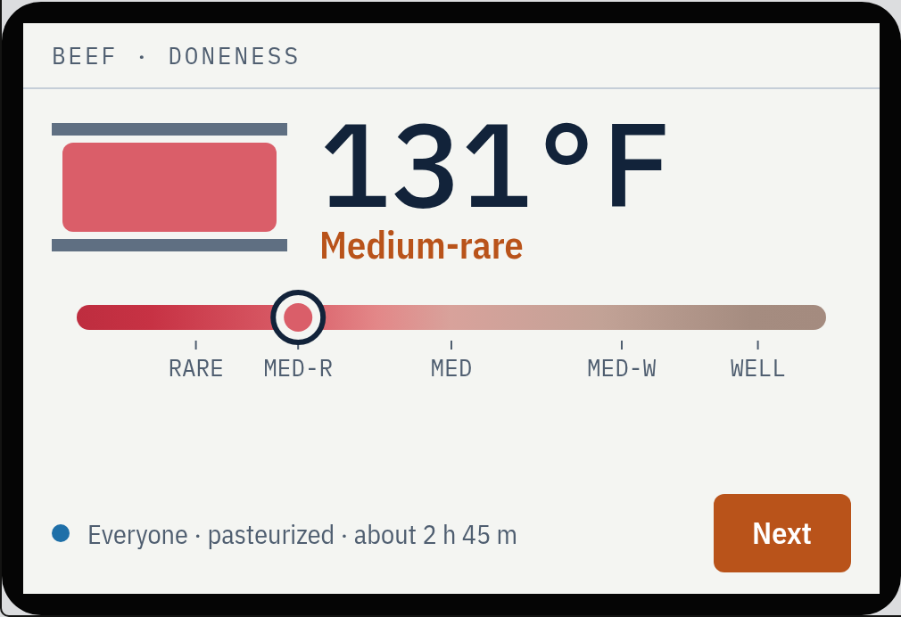
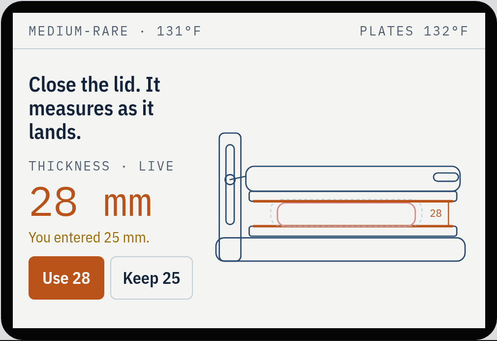
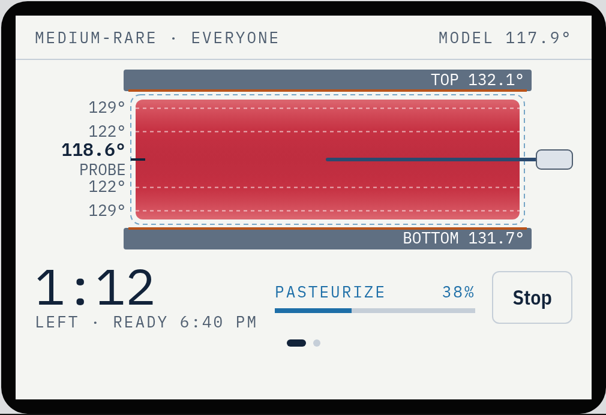
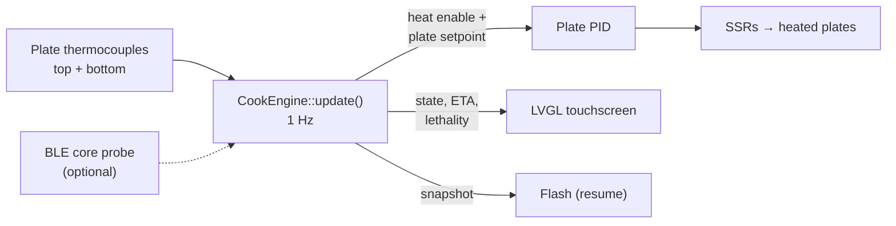

# Vide Sec

*Vide sec* ("dry vacuum") is **dry sous vide**: the bagged food cooks between two heated plates
instead of in a water bath. It reaches a precise core temperature much faster than a water bath,
and without a tub of water. The project covers the cook engine, the touchscreen UI and the hardware
bring-up tools for a countertop appliance that a non-technical person can use safely.

> **Showcase repository.** The source code for this project is private. This page covers what
> it does, how it's built and what it looks like.

## Highlights

- **Model-based cooking**: a thermal model of the food (thickness and plate temperatures)
  predicts the core temperature, so no probe is needed
- **Enforced pasteurization**: hold times are computed from published food-safety data and
  enforced in firmware, not just shown as a warning. Progress is tracked as accumulated
  lethality
- **Optional wireless probes** (Chef iQ first, with a brand-neutral interface) give a measured
  core temperature and feed calibration data back into the model
- **Frozen food** goes straight in, with a contact check
- Doneness presets per food (beef, pork, poultry, fish, vegetables, manual), *ready-by*
  scheduling and an optional sear stage
- **Conservative resume after a power cut**: the cook state is snapshotted to flash. After a
  reboot, physics-based bounds decide whether the food is still safe to continue; if the
  outage length is unknown, the cook ends in a fault
- Lid-driven flow: close the lid to start (after a countdown, using the measured thickness),
  open it to pause

## Cook flow

Pick a food and doneness, load it, close the lid, and the cooker does the rest. Two themes,
**Graphite** (dark) and **Blueprint** (light), share one layout.

| Ask | Load | Cook |
|:---:|:---:|:---:|
|  |  |  |
| Drag the doneness bar; the pasteurization time and total estimate update live | Close the lid: plate gap measures the food's thickness as it lands | Cross-section shows the modelled temperature through the food, probe reading and pasteurization progress |
|  |  |  |

From the UI design canvas (concept "E v2"); the native LVGL port follows it.

## How it works

The thermal model is a 1-D slab heated from both faces, with an enthalpy method so it handles
freezing and thawing. It runs as a **bracket**: a slow and a fast estimate that together cover
the uncertainty in the food. With water-bath assumptions it reproduces Douglas Baldwin's
published sous-vide tables to within 15%. Doneness and safety both come from the model, which
accumulates **lethality** (pathogen reduction integrated over the real time-temperature curve).
A cook ends when the slow estimate has enough, not after a fixed table time.

## Architecture

| Part | What it is |
|---|---|
| `engine/` | Platform-independent C++17 cook engine: `CookEngine::update(inputs) → outputs` once per second. Thermal model, pasteurization, safety rules, probe tracking. **Fully host-tested** |
| `tools/lvgl_ui/` | Native LVGL port of the touchscreen UI for the 4.3" 480×272 Guition JC4827W543C (all screens, with a serial screenshot hook) |
| `ui/concepts/` | Generators for the UI concept boards and the interactive HTML prototype |
| `tools/*_test`, `tools/probe_scan/` | Board bring-up sketches: display, color, LVGL, chime, BLE + Wi-Fi, probe scanning |

The engine only decides *what the plates should do*: heat enable, a plate setpoint, state,
faults and estimates. It is meant to be wrapped by an ESPHome external component or by plain
Arduino / ESP-IDF code.

The engine has a full design document covering the pasteurization sources, a Modernist Cuisine
cross-check, the safety modes, the speed-mode ceiling and findings from simulation, and a host
test suite that runs on every build.

## Hardware (planned)

- ESP32-S3 with an LVGL touchscreen and a rotary knob
- Two heated 3D-printer build plates (top and bottom) with K-type thermocouples, each
  switched by an SSR
- Speaker for chimes, and an addressable LED light bar on the front of the base
- Optional BLE core-temperature probe

## Status

In active development. The cook engine and its tests are complete for the current feature
set, and the UI runs natively on the display board. Heater hardware is not built yet.

> ⚠️ This is an experimental cooking appliance. Food-safety logic is based on published data
> but has not been independently validated, so don't rely on it for food you serve to others.
